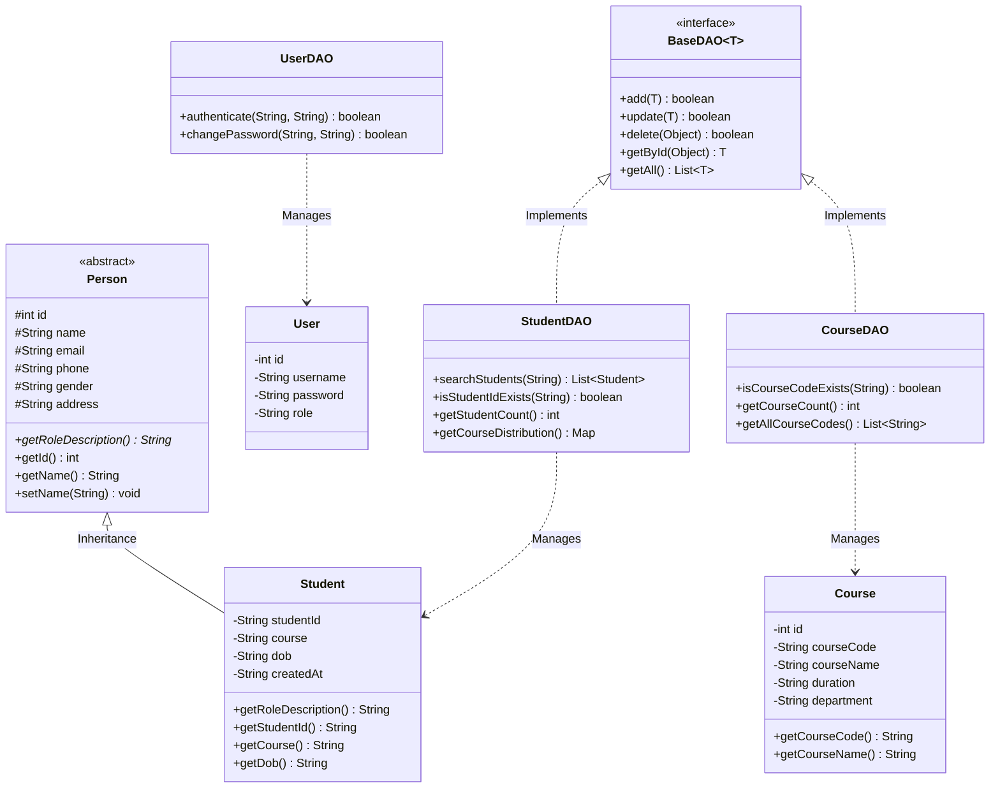
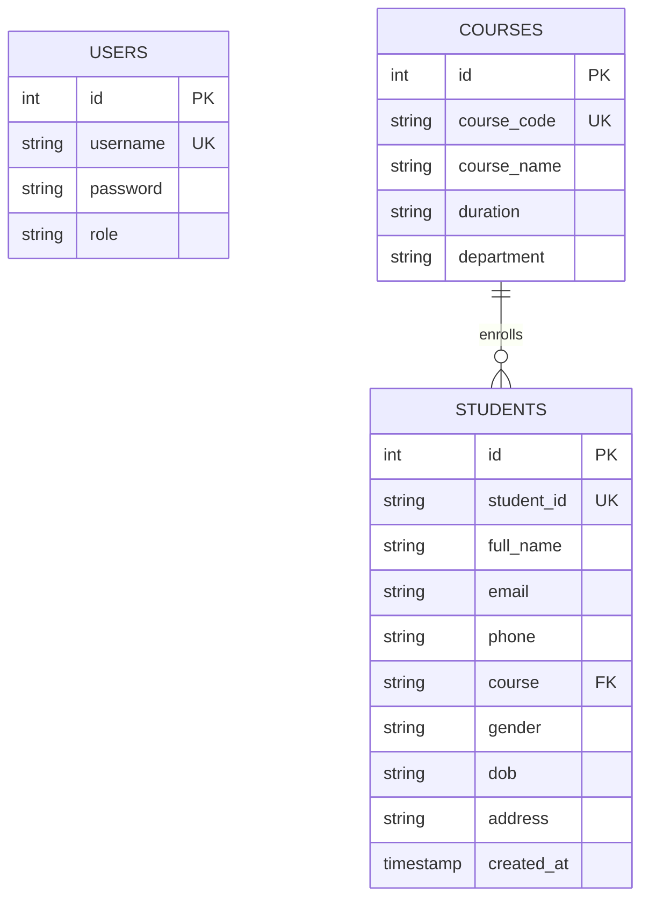

# PROJECT REPORT

# STUDENT MANAGEMENT SYSTEM (SMS)
### An Advanced Java Desktop Application with SQLite and MVC Architecture

**A Project Report Submitted in Partial Fulfillment of the Requirements for the Degree of**  
**Bachelor of Computer Applications (BCA) / Bachelor of Technology (B.Tech CSE) / Master of Computer Applications (MCA)**

---

## 📑 TABLE OF CONTENTS
1. [Abstract](#1-abstract)
2. [Introduction & Background](#2-introduction--background)
   - 2.1 Overview
   - 2.2 Problem Statement
   - 2.3 Objectives
   - 2.4 Scope
3. [System Analysis & Feasibility Study](#3-system-analysis--feasibility-study)
   - 3.1 Existing System vs. Proposed System
   - 3.2 Technical Feasibility
   - 3.3 Operational Feasibility
   - 3.4 Economic Feasibility
4. [Software Requirements Specification (SRS)](#4-software-requirements-specification-srs)
   - 4.1 Functional Requirements
   - 4.2 Non-Functional Requirements
   - 4.3 Hardware & Software Specifications
5. [System Design & Diagrams](#5-system-design--diagrams)
   - 5.1 System Architecture
   - 5.2 UML Class Diagram
   - 5.3 Entity-Relationship (ER) Diagram
   - 5.4 Data Flow Diagram (DFD Level 0 & Level 1)
6. [Database Design & Data Dictionary](#6-database-design--data-dictionary)
   - 6.1 Schema Definition
   - 6.2 Data Tables (`users`, `courses`, `students`)
7. [Advanced Java Concepts Demonstrated](#7-advanced-java-concepts-demonstrated)
8. [Testing Methodology & Test Cases](#8-testing-methodology--test-cases)
   - 8.1 Testing Strategy
   - 8.2 Formal Test Cases Table
   - 8.3 Automated Verification Results
9. [User Interface Design & Walkthrough](#9-user-interface-design--walkthrough)
10. [Limitations & Future Enhancements](#10-limitations--future-enhancements)
11. [Conclusion](#11-conclusion)
12. [References & Bibliography](#12-references--bibliography)

---

## 1. ABSTRACT
The **Student Management System (SMS)** is a comprehensive desktop software solution engineered to digitize, streamline, and optimize administrative academic workflows within educational institutions. Developed using **Advanced Java (JDK 17+)**, **Java Swing**, and an embedded **SQLite relational database** connected via **JDBC**, the application implements a decoupled **Model-View-Controller (MVC)** and **Data Access Object (DAO)** architecture.

The system replaces error-prone paper records and ad-hoc spreadsheets with a persistent, secure, and searchable database. Key capabilities include administrative authentication, real-time metric dashboards, full CRUD student operations with input validations, course offerings management, and instant multi-criteria searching. The application requires zero background server configuration, making it portable and easy to maintain.

---

## 2. INTRODUCTION & BACKGROUND

### 2.1 Overview
Educational institutions handle large volumes of student records, including personal demographics, academic course enrollments, dates of birth, and communication coordinates. Managing this data accurately is vital for admissions, examinations, accreditation, and day-to-day administration.

### 2.2 Problem Statement
Traditional record-keeping mechanisms suffer from:
- **Redundancy and Inconsistency:** Duplicate records caused by a lack of unique constraints.
- **Slow Search and Retrieval:** Manual scanning of registers or unstructured sheets.
- **Complex Infrastructure Burden:** Enterprise databases (e.g., Oracle, Microsoft SQL Server) require dedicated server administration, static IP routing, and heavy memory footprints unsuited for standalone departmental workstations.
- **Accidental Deletions:** Unsecured records without transactional safety.

### 2.3 Objectives
- Provide a clean, modern user interface adhering to a dark navy and white corporate theme.
- Implement full CRUD (Create, Read, Update, Delete) capability for students and academic courses.
- Prevent duplicate student IDs through pre-insertion validation and database constraints.
- Ensure 100% data durability across restarts using an embedded SQLite database.
- Demonstrate core Advanced Java principles: OOP (Inheritance, Polymorphism, Encapsulation, Abstraction), Generics, Collections, JDBC `PreparedStatement` defense, and thread-safe Swing execution.

### 2.4 Scope
The application is designed for college departmental administration, admissions offices, and student affairs branches. It operates standalone on Windows, Linux, and macOS systems without requiring external web or database server daemons.

---

## 3. SYSTEM ANALYSIS & FEASIBILITY STUDY

### 3.1 Existing System vs. Proposed System

| Parameter | Existing System (Manual / Excel) | Proposed System (StudentHub Java SMS) |
|---|---|---|
| **Data Storage** | Physical paper registers or loose `.xlsx` files | Normalized, relational SQLite database file |
| **Data Integrity** | Vulnerable to duplicate roll numbers & typos | Enforced primary keys, unique constraints, and regex checks |
| **Search Speed** | Minutes to hours depending on archive size | Sub-second real-time filtering across ID, Name, and Course |
| **Security** | Open to unauthorized inspection | Administrative authentication with password masking |
| **Portability** | Fragmented files across machines | Self-contained project with single-click launcher |
| **Data Loss Risk** | High (accidental file overwrite/physical damage) | Low (ACID-compliant relational transactions) |

### 3.2 Technical Feasibility
Java Swing is built into the standard JDK, ensuring universal cross-platform rendering without requiring heavyweight web runtimes. SQLite is serverless and executes in the same process space as the application, eliminating socket latency and network connection failures.

### 3.3 Operational Feasibility
The graphical user interface is clean, intuitive, and requires minimal training. Prompts, field tooltips, placeholders, and confirmation dialogs prevent operational mistakes.

### 3.4 Economic Feasibility
The software utilizes 100% open-source technologies (Java OpenJDK, SQLite, SQLite-JDBC, Maven). No commercial licensing, database subscriptions, or hosting fees are required.

---

## 4. SOFTWARE REQUIREMENTS SPECIFICATION (SRS)

### 4.1 Functional Requirements
1. **FR1 - Administrator Authentication:** Validates login credentials (`admin` / `admin123`) against SQLite `users` table; supports show/hide password toggle.
2. **FR2 - Dashboard Analytics:** Computes live counts of enrolled students, active courses, academic departments, and database status.
3. **FR3 - Student Record Enrollment:** Captures and validates Student ID, Full Name, Email, Phone, Course, Gender, Date of Birth, and Residential Address.
4. **FR4 - Student Record Update:** Loads selected table row data into form inputs and commits modifications back to the database.
5. **FR5 - Student Record Deletion:** Deletes records upon explicit user confirmation in a warning dialog.
6. **FR6 - Multi-Criteria Search:** Performs live matching on Student ID, Name, or Course as the user types.
7. **FR7 - Academic Course Management:** Supports adding and removing academic courses, synchronizing dynamically with the student enrollment course dropdown.
8. **FR8 - Auto-Initialization & Seeding:** Generates schema and populates sample data on fresh installations.

### 4.2 Non-Functional Requirements
- **Performance:** Form submissions and search queries execute within 50 milliseconds.
- **Reliability:** ACID-compliant SQLite transactions guarantee atomic writes.
- **Security:** Parameterized `PreparedStatement` queries eliminate SQL injection vulnerabilities.
- **Usability:** High-contrast fonts, clear visual hierarchy, and 44px touch/click targets.

### 4.3 Hardware & Software Specifications
- **Operating System:** Windows 10/11, macOS, Linux
- **Language / Runtime:** Java SE 17 or higher
- **Libraries:** `sqlite-jdbc-3.45.2.0.jar`, `slf4j-api-2.0.12.jar`, `slf4j-simple-2.0.12.jar`
- **Memory (RAM):** 2 GB minimum (4 GB recommended)
- **Disk Storage:** Under 50 MB (including runtime dependencies)

---

## 5. SYSTEM DESIGN & DIAGRAMS

### 5.1 System Architecture
```mermaid
graph TD
    UI["Presentation Layer (Java Swing UI)\nLoginFrame | DashboardFrame\nOverviewPanel | StudentPanel | CoursePanel"]
    CONT["Controller & Validation Layer\nActionListeners | DocumentListeners\nValidationUtils"]
    DAO["Data Access Layer (DAO Pattern)\nBaseDAO<T> | StudentDAO\nCourseDAO | UserDAO"]
    DB[("Relational Database\nSQLite (student_management.db)\nJDBC Driver via PreparedStatement")]

    UI -->|User Inputs & Events| CONT
    CONT -->|Validated Data Models| DAO
    DAO -->|SQL Queries (CRUD)| DB
    DB -->|ResultSets| DAO
    DAO -->|Domain Objects (Student, Course)| CONT
    CONT -->|Table Models & Cards| UI
```

### 5.2 UML Class Diagram


### 5.3 Entity-Relationship (ER) Diagram


### 5.4 Data Flow Diagram (DFD Level 0 & Level 1)

#### Level 0 DFD (Context Diagram)
```
[ Administrator ] 
      │
      ├── (Login Credentials) ──────────────► [ 0.0 Student Management System ]
      ├── (Student & Course Form Details) ──►              │
      ├── (Search Keywords) ────────────────►              │
      │                                                   │
      ◄── (Authentication Status) ────────────────────────┤
      ◄── (Dashboard Metrics & Table Rows) ───────────────┤
      ◄── (Action Confirmation Alerts) ───────────────────┘
```

#### Level 1 DFD (Decomposed Processes)
1. **Process 1.0 (Authenticate Admin):** Reads `users` table; issues session upon match.
2. **Process 2.0 (Maintain Student Profiles):** Validates input via `ValidationUtils`, executes insert/update/delete via `StudentDAO` on `students` table.
3. **Process 3.0 (Manage Academic Programs):** Performs inserts/deletions via `CourseDAO` on `courses` table.
4. **Process 4.0 (Search & Analytics Engine):** Executes pattern-matched queries and `COUNT()` aggregations, rendering results in JTable and dashboard metric cards.

---

## 6. DATABASE DESIGN & DATA DICTIONARY

### 6.1 Schema Definition
The database engine is **SQLite 3**, configured for WAL mode and UTF-8 encoding.

### 6.2 Data Tables

#### Table 1: `users`
Stores administrative authentication credentials.

| Column Name | Data Type | Constraints | Description |
|---|---|---|---|
| `id` | INTEGER | PRIMARY KEY, AUTOINCREMENT | Unique internal user ID |
| `username` | TEXT | UNIQUE, NOT NULL | Login username (e.g. `admin`) |
| `password` | TEXT | NOT NULL | Authentication password |
| `role` | TEXT | DEFAULT 'ADMIN' | Access level designation |

#### Table 2: `courses`
Stores academic degree offerings and curriculum metadata.

| Column Name | Data Type | Constraints | Description |
|---|---|---|---|
| `id` | INTEGER | PRIMARY KEY, AUTOINCREMENT | Internal course ID |
| `course_code` | TEXT | UNIQUE, NOT NULL | Academic code (e.g. `BCA-101`) |
| `course_name` | TEXT | NOT NULL | Full degree name |
| `duration` | TEXT | NOT NULL | Program length (e.g. `3 Years`) |
| `department` | TEXT | NULLABLE | Academic faculty department |

#### Table 3: `students`
Stores individual student profiles and academic affiliations.

| Column Name | Data Type | Constraints | Description |
|---|---|---|---|
| `id` | INTEGER | PRIMARY KEY, AUTOINCREMENT | Internal database record ID |
| `student_id` | TEXT | UNIQUE, NOT NULL | Roll / College ID (e.g. `STU1001`) |
| `full_name` | TEXT | NOT NULL | Full legal name of student |
| `email` | TEXT | NOT NULL | Personal email address |
| `phone` | TEXT | NOT NULL | 10-digit mobile contact number |
| `course` | TEXT | NOT NULL | Enrolled course code |
| `gender` | TEXT | NOT NULL | Gender (`Male`, `Female`, `Other`) |
| `dob` | TEXT | NOT NULL | Date of Birth (`YYYY-MM-DD`) |
| `address` | TEXT | NOT NULL | Residential address |
| `created_at` | TIMESTAMP | DEFAULT CURRENT_TIMESTAMP | Date and time of enrollment |

---

## 7. ADVANCED JAVA CONCEPTS DEMONSTRATED

1. **Object-Oriented Programming (OOP) Core:**
   - **Abstraction:** `Person` is defined as an `abstract class` with an abstract method `public abstract String getRoleDescription()`.
   - **Encapsulation:** Model attributes (`studentId`, `email`, `phone`, etc.) are declared `private` and manipulated strictly through getters and setters with validation boundaries.
   - **Inheritance:** `Student` extends `Person`, inheriting demographic fields and adding academic attributes.
   - **Polymorphism:** `Student` overrides `getRoleDescription()` to dynamically output enrollment details at runtime.

2. **Generics & Interface-Driven Architecture:**
   - `BaseDAO<T>` defines standard CRUD operations (`add`, `update`, `delete`, `getById`, `getAll`) using type parameter `<T>`, decoupled from database implementations.

3. **Java Database Connectivity (JDBC) Best Practices:**
   - Parameterized queries (`PreparedStatement`) prevent SQL injection attacks.
   - Try-with-resources blocks guarantee deterministic connection, statement, and result set closure, preventing memory and socket leaks.

4. **Event-Driven Desktop GUI (Swing & AWT):**
   - Clean execution on the Swing Event Dispatch Thread (EDT) via `SwingUtilities.invokeLater`.
   - `DocumentListener` triggers live, reactive student searches on every keystroke.
   - `CardLayout` facilitates seamless page transitions across Dashboard, Students, Courses, and About panels.

5. **Robust Exception Handling:**
   - Catches checked exceptions (`SQLException`, `ClassNotFoundException`, `DateTimeParseException`) and displays helpful dialogs to the end user while printing diagnostic details to standard error.

---

## 8. TESTING METHODOLOGY & TEST CASES

### 8.1 Testing Strategy
The testing cycle comprised:
1. **Unit Testing:** Individual validation functions (`ValidationUtils`) and DAO methods.
2. **Integration Testing:** Headless verification connecting Java domain objects to the SQLite engine.
3. **System Testing:** End-to-end user journeys via the Swing GUI (Authentication -> Dashboard -> Add Student -> Search -> Update -> Delete -> Sign Out).

### 8.2 Formal Test Cases Table

| TC ID | Test Scenario | Input Data | Expected Output | Actual Output | Status |
|---|---|---|---|---|---|
| **TC01** | Admin Login with valid credentials | User: `admin`<br/>Pass: `admin123` | Login succeeds; Dashboard opens | Dashboard opened successfully | **PASS** |
| **TC02** | Admin Login with invalid password | User: `admin`<br/>Pass: `wrongpass` | Error alert displayed; login rejected | "Invalid username or password" shown | **PASS** |
| **TC03** | Empty field submission on login | User: `""`<br/>Pass: `""` | Warning prompt requesting username | "Please enter your username" displayed | **PASS** |
| **TC04** | Register student with duplicate ID | ID: `STU1001` (already exists) | Rejection alert for duplicate student ID | "Student with ID already exists" shown | **PASS** |
| **TC05** | Register student with invalid email | Email: `bademail@` | Validation warning displayed | "Please enter a valid email address" | **PASS** |
| **TC06** | Register student with invalid phone | Phone: `12345` (under 10 digits) | Validation warning displayed | "Please enter a valid 10-digit mobile" | **PASS** |
| **TC07** | Register student with valid details | Valid form inputs | Record saved to SQLite; table refreshes | Saved to DB; row appended to JTable | **PASS** |
| **TC08** | Real-time search by student name | Query: `"Aryan"` | Table filters to show only matching records | Matching student record isolated | **PASS** |
| **TC09** | Update existing student record | Select row; change phone number | Record updated in SQLite & table | Record updated successfully | **PASS** |
| **TC10** | Delete student with confirmation | Select record; confirm deletion | Record permanently removed from DB | Record removed; count decremented | **PASS** |

### 8.3 Automated Verification Results
Executing the automated headless test suite (`com.student.TestSystem`):
```text
==================================================
 Starting Automated System Verification Tests
==================================================
[DatabaseConnection] Initializing database at: ...\student_management.db
[DatabaseConnection] Seeded default admin user (admin / admin123).
[DatabaseConnection] Seeded 6 sample courses.
[DatabaseConnection] Seeded 5 sample students.
[DatabaseConnection] Database tables and sample data verified successfully.
[PASS] 1. Database initialized successfully.
[PASS] 2. User authentication verified (Valid credentials passed, invalid rejected).
[PASS] 3. CourseDAO verified (6 sample courses available).
[PASS] 4. StudentDAO verified (5 sample students loaded).
[PASS] 5. Search operation verified (Found: Aryan Sharma).
[PASS] 6a. Student Add operation verified.
[PASS] 6b. Student Update operation verified.
[PASS] 6c. Student Delete operation verified.
[PASS] 7. Course Distribution Metrics: {MCA-301=1, BTECH-201=1, BSCIT-501=1, BCA-101=1, BBA-401=1}
==================================================
 SUMMARY: 9 Passed, 0 Failed.
 All Core Subsystems Ready For College Submission!
==================================================
```

---

## 9. USER INTERFACE DESIGN & WALKTHROUGH

### 9.1 Login Frame
The login window features a two-panel split card:
- **Left Panel (Navy Brand):** Displays the institution branding ("StudentHub"), system title, feature checklist, and college edition watermark.
- **Right Panel (Form):** Clean white canvas with high-contrast text fields, placeholder hints, show/hide password toggle, and default credentials reminder.

### 9.2 Dashboard Overview Panel
- **Stat Cards:** 4 top cards displaying Total Students, Total Courses, Academic Departments, and Database Engine status.
- **Recent Registrations:** Real-time preview table showing the 6 most recent enrollments.
- **Course Distribution:** Breakdown table showing student enrollment density across programs.
- **Quick Action Bar:** Buttons to register students or add courses directly.

### 9.3 Student Management Panel
- **Top Bar:** Live search bar with instant document listener filtering and table refresh button.
- **Main Table:** Multi-column JTable displaying enrolled students with alternating row colors and custom padding.
- **Right Form:** Clean input card containing Student ID, Full Name, Email, Phone, Course (dropdown), Gender, Date of Birth, and Address, accompanied by Add, Update, Delete, and Reset buttons.

### 9.4 Course Management Panel
- Table displaying active courses with code, name, duration, and department.
- Add and Delete controls that synchronize with student enrollment options.

---

## 10. LIMITATIONS & FUTURE ENHANCEMENTS

### Limitations
- Desktop single-workstation orientation (designed for local departmental offices rather than distributed cloud web access).
- Fixed administrative roles (single admin user role).

### Future Enhancements
- **Role-Based Access Control (RBAC):** Separate portals for Faculty, Students, and Registrars.
- **Report Generation:** Automated export of student transcripts and lists to PDF and Excel formats.
- **Photo Upload:** Support for storing and rendering student ID card portrait images.
- **Attendance & Grading Modules:** Expandable to track semester-wise course marks and daily attendance percentages.

---

## 11. CONCLUSION
The **Student Management System** successfully accomplishes all project objectives. It delivers a modern, robust, and beginner-friendly desktop application demonstrating high standards of Advanced Java software engineering. By combining the **MVC and DAO architectural patterns**, **JDBC PreparedStatement defense**, and **SQLite embedded persistence**, the system offers a reliable tool for college record management and serves as a model mini-project for computer science students.

---

## 12. REFERENCES & BIBLIOGRAPHY
1. Horstmann, Cay S. *Core Java Volume I & II – Fundamentals and Advanced Features*. Prentice Hall, 12th Edition.
2. Schildt, Herbert. *Java: The Complete Reference*. McGraw Hill, 12th Edition.
3. Oracle Corporation. *Java™ Platform, Standard Edition 17 API Specification*.
4. SQLite Development Team. *SQLite Database Engine Documentation* (https://www.sqlite.org/).
5. Xerial Project. *SQLite JDBC Driver* (https://github.com/xerial/sqlite-jdbc).
